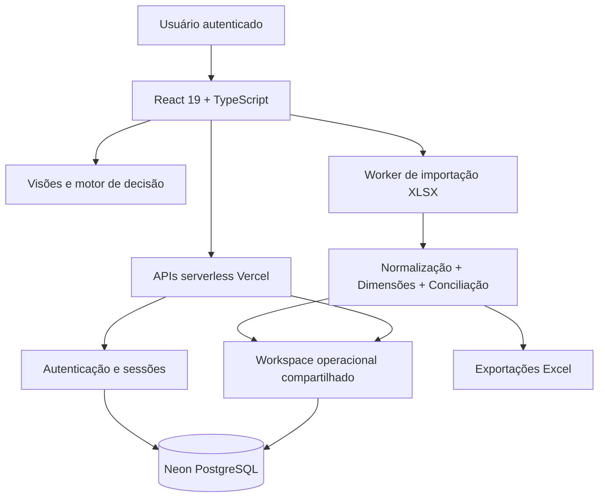
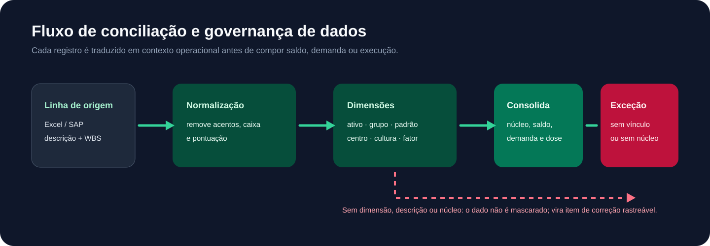

# AgroNexus 360°

<p align="center">
  
</p>

<p align="center"><strong>Planejamento agrícola, conciliação SAP, abastecimento e logística operacional em uma única plataforma.</strong></p>

<p align="center">
  <a href="https://agronexus-360.vercel.app">Aplicação em produção</a> ·
  <a href="#arquitetura-atual">Arquitetura</a> ·
  <a href="#motor-de-conciliação">Conciliação</a> ·
  <a href="#logística-de-carregamento">Logística</a> ·
  <a href="#fechamentos-comerciais">Fechamentos</a>
</p>


> Projeto pessoal de **Emmanuel Fortunato**, Analista de Planejamento. O AgroNexus 360° transforma regras reais de planejamento, planilhas Excel e relatórios SAP em uma experiência operacional auditável, compartilhada e orientada à decisão.

## Índice

- [Problema que resolve](#problema-que-resolve)
- [Diferenciais profissionais](#diferenciais-profissionais)
- [Capacidades da plataforma](#capacidades-da-plataforma)
- [Arquitetura atual](#arquitetura-atual)
- [Fontes de dados e importação](#fontes-de-dados-e-importação)
- [Motor de conciliação](#motor-de-conciliação)
- [Visões operacionais](#visões-operacionais)
- [Logística de carregamento](#logística-de-carregamento)
- [Fechamentos comerciais](#fechamentos-comerciais)
- [Segurança, perfis e persistência](#segurança-perfis-e-persistência)
- [Como executar](#como-executar-localmente)
- [Operação e publicação](#operação-e-publicação)
- [Roadmap técnico](#roadmap-técnico)

## Problema que resolve

O planejamento de insumos não termina quando a demanda é aprovada. A operação precisa conciliar continuamente plano agrícola, execução, consumo, saldo físico, materiais em trânsito, pedidos pendentes, estoque em armazéns e exceções de cadastro.

Antes do AgroNexus, essa leitura ficava dispersa entre relatórios SAP, Power Query, tabelas dinâmicas, fórmulas e conhecimento tácito. A plataforma organiza essas informações em respostas operacionais claras:

- Quanto do planejamento já foi executado por ciclo, cultura, grupo, subgrupo e núcleo?
- Qual volume ainda precisa ser aplicado e qual é o impacto de uma dose diferente da planejada?
- Há saldo no núcleo, trânsito, armazém ou risco real de ruptura?
- Qual produto precisa de repasse antes da próxima janela de aplicação?
- Qual material não conciliou e exige uma nova premissa ou correção na origem?
- O que foi fechado comercialmente, onde será entregue, quando será faturado e quanto falta vincular ao pedido de compra?
- Qual motorista, veículo, nota fiscal, solicitação e material pertencem à mesma viagem de carregamento?

O objetivo não é apenas exibir indicadores: é deixar explícitas as regras de negócio para que a decisão seja repetível, rastreável e mais rápida.

## Diferenciais profissionais

| Competência | Evidência no projeto |
| --- | --- |
| Conhecimento de negócio | Traduz fluxo de safra, calendário agrícola, abastecimento, faturamento e logística em produto digital. |
| SAP e Excel aplicados | Integra Planejamento, ZPS007, CN52, ZMM_BATCH, MB52, MB5T, pedidos pendentes, solicitações web e pedidos de compra. |
| Engenharia de dados | Normaliza nomes, converte apresentações, aplica fallbacks e mantém exceções como dados auditáveis. |
| Produto operacional | Interface responsiva, filtros, agrupamentos, expansão por detalhe, exportações Excel e ações contextualizadas. |
| Arquitetura full-stack | Frontend React, APIs serverless, autenticação por sessão, base PostgreSQL central e payload compactado. |
| Governança | Perfis administrativos e operadores por núcleo, histórico de tarefas, premissas e trilha de auditoria. |
| Autonomia | Projeto pessoal publicado, versionado e evoluído a partir de situações reais de planejamento. |

## Capacidades da plataforma

| Módulo | Entrega operacional |
| --- | --- |
| Visão geral | Prioridades do dia, riscos, pedidos urgentes, execução por subgrupo, cultura e DAE por núcleo; avisa rotas ativas e direciona à logística. |
| Calendarização | Provisionamento por intervalo de datas com demanda, saldo, trânsito, armazém, apoio entre núcleos e volume solicitado. |
| Acompanhamento | Visão por princípio ativo, material padrão, material físico e localização; totais, estoque convertido/físico e saldo a faturar por ciclo, núcleo e pedido vinculado. |
| Execução | Planejado x aplicado, percentual executado, dose planejada x utilizada e impacto da diferença de dose. |
| Importações | Validação de fontes, metadados, data de arquivo, frescor da base e relatório de itens não conciliados. |
| Alertas | Repasse em até 30 dias, risco de disponibilidade, variação expressiva de dose e vencimento de estoque. |
| Tarefas | Farol de pedidos, filtros, histórico de ações, vínculo a pedido/material e exportação. |
| Premissas | Visão tabulada e editável de dimensões, conversões, centros, núcleos, culturas e regras operacionais. |
| Logística | Reservas por saldo de pedido SAP, veículos, motoristas, rota multi-item, status, solicitação WebAgil, NF, agendamento, receitas, sequência de paradas e documentos `.eml`/Excel. |
| Fechamentos | Distribuições comercialmente fechadas, calendarização mensal, preço médio hierárquico, forma de pagamento, anotações e vínculo posterior aos pedidos de compra. |
| Usuários | Login, sessão, administração de contas e recorte de acesso para operadores por núcleo. |

## Arquitetura atual



### Componentes técnicos

| Camada | Tecnologias | Responsabilidade |
| --- | --- | --- |
| Interface | React 19, TypeScript, Vite/Vinext, Tailwind CSS, Lucide | Navegação, filtros, tabelas, cards, acessibilidade e responsividade. |
| Processamento de planilhas | SheetJS (`xlsx`) + Web Workers | Leitura de Excel e processamento de importações fora da thread principal. |
| Regras de domínio | TypeScript em `lib/` | Conciliação de materiais, WBS, núcleo, saldo, trânsito, conversões e provisionamento. |
| Autenticação | API Vercel + Node `crypto` | Senha com `scrypt` e salt, sessão com token aleatório e cookie `HttpOnly`, `Secure`, `SameSite=Lax`. |
| Persistência central | Neon Serverless PostgreSQL | Usuários, sessões e workspace operacional compartilhado. |
| Transporte de workspace | JSON compactado em GZIP/Base64 | Reduz transferência e tempo de inicialização sem perder o conjunto operacional. |
| Deploy | Vercel | SPA estática e funções serverless para autenticação, usuários, alertas e workspace. |

### Estrutura do repositório

```text
plataforma/
├── app/
│   ├── page.tsx                    # Interface, estados, regras de visualização e fluxos
│   ├── globals.css                 # Tokens, tema e responsividade
│   └── layout.tsx                  # Metadados e ícone da aplicação
├── api/
│   ├── _core.js                    # PostgreSQL, usuários, sessões e compactação
│   ├── auth.js                     # Login, sessão atual e logout
│   ├── users.js                    # Administração de usuários
│   ├── workspace.js                # Leitura/gravação do workspace central
│   ├── resolve-map.js              # Resolve links Google Maps para rota utilizável
│   └── send-alert.js               # Integração de alerta por e-mail quando configurada
├── components/
│   └── dimension-upload.tsx        # Importação e edição de dimensões/premissas
├── lib/
│   ├── reconciliation.ts           # WBS, núcleo, saldo, trânsito e reconciliação
│   ├── material-dimension.ts       # Material padrão, ativo, grupo, subgrupo e fator
│   └── operational-normalization.ts # Normalização e leitura tolerante de campos
├── workers/
│   ├── import-worker.ts            # Parsing de planilhas em segundo plano
│   └── workspace-codec.worker.ts   # GZIP/Base64 do workspace no navegador
├── scripts/                         # Diagnósticos, compactação e verificações administrativas
├── public/agronexus-favicon.svg     # Identidade visual do navegador
├── docs/assets/                     # Diagramas utilizados neste README
├── vite.vercel.config.ts            # Build voltado para Vercel
└── vercel.json                      # Build e fallback da SPA
```

### Workspace compartilhado

O dado operacional não depende mais apenas do navegador local. A aplicação armazena um workspace central em `agronexus_platform_workspace`, com chave única `operacional`, para que os usuários autorizados trabalhem sobre a mesma base.

O cliente mantém uma cópia leve no IndexedDB somente como apoio de interface. Dados operacionais completos vêm da base central; isso evita duplicar dezenas de megabytes localmente e reduz os travamentos observados nas primeiras cargas.

O formato do payload usa:

```text
PersistedWorkspace
  ├── datasets             # fontes importadas e respectivas linhas
  ├── dimensions           # dimensões e fatores de conversão
  ├── tasks                # tarefas e histórico de ações
  ├── logistics            # motoristas, veículos e viagens
  ├── commercialClosings   # distribuições, vínculo de pedido e anotações
  ├── premises             # parâmetros operacionais
  ├── emailSettings        # destinatários e regras de alerta
  └── dashboardSettings    # preferências, como ciclo de DAE
```

## Fontes de dados e importação

| Fonte | Papel | Exemplos de campos reconhecidos |
| --- | --- | --- |
| Planejamento | Demanda, dose, WBS, área e data prevista | Material, Classificação, Atividade, Talhão, WBS, volume, área e data. |
| ZPS007 | Execução e área registrada | DiagRede, operação, status e área executada. |
| CN52 | Consumo/aplicado | Elemento PEP, centro, talhão, material e quantidade retirada. |
| ZMM_BATCH | Estoque prioritário | Centro, depósito, lote, utilização livre, nome/local de estoque especial. |
| MB52 | Complemento de estoque e valor de carga | Usado somente quando a apresentação não aparece na BATCH; `Val.utiliz.livre` é a fonte prioritária do valor disponível. |
| MB5T | Materiais em trânsito | Centro, destino, material e quantidade. |
| Pedidos pendentes | Demanda em aberto | Pedido, produto, volume e `DtRemPed`. |
| Dimensões.xlsx | Semântica e regras | Ativo, grupo, subgrupo, padrão, conversão, centro, núcleo e cultura. |
| Estoque webAgil | Saldo disponível para carregamento | Produto, lote, saldo, paletes e armazém. |
| Relação de solicitação webAgil | Solicitações de carregamento | Solicitação, destino, produto, lote, quantidade e unidade. |
| Pedidos de compra | Vínculo de fechamentos | Número do pedido, fornecedor, item e quantidade fornecida. |

### Contrato de atualização

1. Um administrador seleciona as fontes na Central de importações.
2. O worker identifica cabeçalhos tolerando variantes de acento, abreviação e pontuação.
3. Os registros são normalizados e conciliados contra as dimensões.
4. O workspace compactado é persistido na base central e passa a atender os demais usuários.
5. A tela mostra data de arquivo, data de carga e situação de atualização.
6. Itens sem correspondência viram exceções exportáveis; não se tornam saldo ou planejamento artificial.

> Dimensões e Planejamento são bases de referência: não devem receber o aviso de atraso como se fossem fontes de execução diária.

## Motor de conciliação

<p align="center">
  
</p>

### Material: semântica antes do código SAP

O código SAP é mantido para auditoria, mas a chave operacional é formada pela descrição normalizada. A hierarquia utilizada é:

```text
Princípio ativo
  └── Material agregado (padrão)
        └── Material físico / apresentação de estoque
```

Exemplo de normalização:

```text
"VÉRTIMEC 84 SC"  → VERTIMEC84SC
"Vertimec-84 SC"  → VERTIMEC84SC
```

Isso reduz falsos negativos por acento, caixa, hífen, espaços ou variações de apresentação. Quando uma relação padrão → físico possui fator, o sistema apresenta estoque convertido e, em detalhe, o saldo físico real.

### WBS, talhão e núcleo

O padrão de WBS é interpretado a partir de:

```text
[Cultura].[Fazenda].[Safra].[Talhão].[Índice da divisão]

A = 1 · B = 2 · C = 3 · D = 4 · E = 5
```

Regras operacionais relevantes:

| Contexto | Regra | Resultado |
| --- | --- | --- |
| Planejamento | Talhão iniciado por `TL` | `NC-TP` |
| Planejamento | Talhão iniciado por `FM` | `NC-STM` |
| Planejamento | Talhão iniciado por `BM` | `NC-BBJ` |
| Planejamento | Núcleo `NC-VER` | `NC-AGV` |
| CN52 | Unidade/talhão com regra BBJ, STM ou TP | Núcleo específico na execução |
| Estoque | Centro `FVR1` | `NC-TP` |
| Estoque | Depósito vazio ou centro `0714` | Armazém central |

Essas regras são contextuais: uma exceção de estoque não reescreve silenciosamente planejamento, execução ou trânsito.

### BATCH, MB52, armazém e lote

| Conceito | Regra |
| --- | --- |
| BATCH | Fonte prioritária: contém lote, saldo e descrição de armazém/cidade. |
| MB52 | Fallback apenas para materiais ausentes na BATCH; evita dupla contagem. |
| Fazenda | Saldo com depósito preenchido, exceto o tratamento específico de armazém. |
| Armazém | Centro `0714` ou depósito vazio; localização usa nome e local do estoque especial quando disponível. |
| Lote | Não fragmenta os visuais decisórios: é consolidado por material, tipo de saldo e localização. |
| Saldo zero | Não é oferecido como apoio de fazenda, armazém ou outro núcleo. |

### Fórmulas que orientam decisão

```text
Demanda da janela       = max(0, planejado − aplicado)
Disponibilidade local   = saldo na fazenda + trânsito
Saldo após atendimento  = disponibilidade local + apoio − demanda
A entregar              = saldo + aplicado + trânsito − quantidade planejada
Impacto de dose         = volume executado − (dose planejada × área executada)
```

O provisionamento aloca saldo central uma única vez por material agregado. Depois disso, sugere apoio de outros núcleos somente para o saldo realmente disponível.

### Governança de exceções

| Exceção | Interpretação | Ação sugerida |
| --- | --- | --- |
| Material sem dimensão | A origem contém uma descrição ainda sem padrão operacional. | Cadastrar novo vínculo ou corrigir a grafia. |
| Núcleo não conciliado | Centro, fazenda ou talhão não possui regra correspondente. | Atualizar a dimensão Centro/Fazenda → Núcleo. |
| Dados incompletos | Campo necessário não veio da fonte. | Corrigir exportação SAP/Excel antes da decisão. |
| Conversão indefinida | Há material físico sem fator para o padrão. | Completar a dimensão de conversão. |

O sistema privilegia ausência explícita de conciliação em vez de transformar incerteza em número zero.

## Visões operacionais

### Visão geral

- Centro de decisão com riscos, pendências e pedidos urgentes.
- Execução por grupo e subgrupo, separando Safra e Safrinha.
- Área planejada baseada no Planejamento filtrado por `Classificação = Atividade` e `Atividade = PLANTIO SEM ADUBO`, evitando duplicação de hectares.
- DAE por núcleo, cultura e data de plantio, respeitando o ciclo configurado.
- Aviso de rotas em status **Rota ativa**, com atalho direto para Logística.

### Calendarização e provisionamento

- Data inicial e final de avaliação configuráveis.
- Demanda baseada na data prevista do Planejamento.
- Saldo de fazenda, trânsito, pedidos pendentes, armazém e sugestão de apoio entre núcleos.
- Leitura micro por núcleo, material e localização, sem dividir volumes por lote.
- Exportação Excel com visão executiva e detalhada.

### Acompanhamento

- Agrupamento por princípio ativo com total de planejado, estoque, trânsito, aplicado, a entregar e solicitado.
- Filtros por ciclo, grupo, subgrupo, cultura, núcleo e busca textual.
- Expansão progressiva: padrão → material em estoque → localização.
- Identificação de saldo convertido e saldo físico do material quando há fator de conversão.
- Armazém em linha própria com descrição de cidade/localização.
- Coluna **A faturar** calculada pelo saldo do fornecedor (`Saldo Forn`) do pedido de compra vinculado, respeitando ciclo e destino da distribuição.

### Execução

- Comparação entre volumes planejados e aplicados.
- Percentual por subgrupo e ciclo.
- Dose usada ao lado da dose planejada, com impacto absoluto de volume.
- Segmentação por cultura, ciclo, grupo e subgrupo.

### Alertas e tarefas

- Alertas para produto necessário em até 30 dias sem saldo na fazenda.
- Priorização de repasse a partir de armazém, destacando a localização do saldo.
- Detecção de aumento relevante de dose e itens vencidos.
- Farol de pedidos com base em `DtRemPed`: demanda próxima, possível atraso, atenção e alerta.
- Registro de ações com material/pedido vinculado, histórico paginado e exportação Excel.

## Logística de carregamento

O módulo **Logística** é administrativo e usa as fontes `Estoque webAgil` e `Relação de solicitação webAgil`.

### Configuração rodoviária

- Cadastro de motorista: nome completo, CPF e telefone opcional.
- Cadastro de veículo: placa, modelo, capacidade em quilogramas e paletes, isca/rastreador, tipo interno/terceiro e motorista padrão por placa.
- Cadastro de premissas de rota a partir de uma lista controlada de centros, armazéns e núcleos, com município e link de endereço específico para o mapa.
- Proteção contra excluir motorista ou veículo já vinculado a uma viagem.

### Emissão: uma rota, vários pedidos SAP

Uma viagem não está limitada a um único pedido ou material SAP. O fluxo preserva a separação entre o planejamento de rota e a solicitação operacional do webAgil:

```text
Selecionar pedido SAP com saldo restante
        ↓
Selecionar material físico e saldo consolidado na origem
        ↓
Adicionar item à carga e repetir para os demais pedidos
        ↓
Selecionar data, motorista e veículo
        ↓
Emitir uma viagem única
        ↓
Vincular NF, solicitação webAgil e receitas posteriormente
```

Cada item da rota preserva seu pedido SAP, data solicitada, produto solicitado, produto físico, código, quantidade, origem e destino. O lote não é reservado durante o planejamento: ele é definido no carregamento físico. A viagem concentra a data operacional, motorista, veículo, status, notas fiscais e receitas.

O ciclo configurado da plataforma também orienta a leitura de necessidade. Quando o material do pedido só está planejado em outro ciclo, a tela mantém o pedido disponível, mas mostra o aviso de divergência para que a expedição não seja interpretada com uma demanda incorreta.

### Regras de reserva, capacidade e valor

| Regra | Comportamento operacional |
| --- | --- |
| Saldo de pedido SAP | A quantidade emitida é descontada do saldo disponível do pedido/material. Pedidos totalmente reservados deixam de aparecer na fila para impedir duplicação de volume. Viagens legadas também são reconhecidas por pedido e produto. |
| Estoque da origem | O armazém usa saldo consolidado por material/local; coleta em fazenda usa a unidade com saldo disponível. Materiais sem pedido podem usar o estoque geral. |
| Lote | O lote não é escolhido na reserva inicial; a rota mostra `lote a definir` até a operação física. |
| Peso | Apenas massa explicitamente reconhecida em kg é usada para validar a capacidade. Litros e mililitros não viram kg sem uma densidade cadastrada, evitando conversões incorretas como `2.000 UN × 20 L = 40.000 kg`. |
| Paletes | A carga acumula os paletes informados no estoque webAgil e compara com a capacidade do veículo. |
| Valor da carga | O valor unitário é derivado do estoque SAP, priorizando `MB52[Val.utiliz.livre]`, e é acumulado por item na rota. Cargas acima de R$ 1 milhão sinalizam necessidade de escolta e isca. |
| Mesma placa/data | Ao escolher uma data já usada pela mesma placa, a tela apresenta aviso antes da emissão; o usuário pode confirmar a disponibilidade e seguir. |

### Pós-emissão e rastreabilidade

- Status de operação por viagem: **Em progresso** (fiscal/agendamento), **Rota ativa** (veículo em deslocamento) e **Concluído**.
- A solicitação webAgil é vinculada apenas depois que a rota SAP existe. Uma mesma solicitação pode pertencer a somente uma viagem, e o volume de cada linha é consumido na vinculação para impedir uso infinito de uma solicitação.
- Notas fiscais são vinculadas após a emissão, no bloco fiscal de **destino + responsável (AG)**. A NF só é liberada após selecionar a linha/volume da solicitação WebAgil correspondente; blocos concluídos saem da fila de vínculo e podem ser alterados somente pela edição da viagem.
- O e-mail externo é gerado como arquivo `.eml`, com seleção de todos ou somente dos blocos externos concluídos. O conteúdo só contempla blocos cujo AG difere de Boa Esperança Agropecuária.
- O agendamento é único por viagem, recebe o número de sete dígitos informado pelo usuário e pode reunir várias solicitações.
- O roteiro de grupo possui sequência ajustável de coleta e destinos; a mensagem operacional é reconstruída na mesma ordem escolhida.
- A receita permite várias recomendações por viagem. O seletor único `Fazenda destino · Produto` consome o volume da carga e evita indicar material que não segue para aquela unidade. Cultura e alvo são registrados por recomendação; itens sem receita podem ser marcados e ficam fora do pedido ao agrônomo.
- Ao concluir a etapa de receita, a plataforma prepara um `.eml` com tabela `Fazenda destino | Produto | Volume | Cultura | Alvo` e assunto `CARREGAMENTO <MOTORISTA> - <DATA>`.
- O documento Excel é gerado com **uma linha por item da rota** e inclui data, status, pedido, origem, destino, motorista, placa, NF e dados de receita.
- Operadores não criam ou editam viagens: veem somente viagens em **Rota ativa**, para qualquer unidade, com a tabela operacional `Fazenda destino | Produto | Volume` e sem valores financeiros.

Viagens legadas de uma única solicitação continuam compatíveis com o modelo novo.

## Fechamentos comerciais

O módulo **Fechamentos** também é exclusivo de administradores e cobre a sequência abaixo:

```text
Comercial repassa o fechamento
        ↓
Planejamento distribui por destino e mês
        ↓
Distribuição/calendarização é repassada à operação
        ↓
Pedido de compra é criado e vinculado posteriormente
```

### Distribuições carregadas

As distribuições históricas do arquivo **Resumo fechamentos 26-27** foram carregadas diretamente na base central, sem criar uma nova opção de importação. Cada distribuição conserva fornecedor, vencimento, destino, local de entrega, cultura, princípio ativo, produto, unidade, preço, embalagem, total e volumes mensais.

No cadastro, destino e princípio ativo são oferecidos a partir das premissas vigentes. A forma de pagamento é obrigatória e aceita o detalhamento negociado — por exemplo, barter, caixa ou outra modalidade. Ao vincular um pedido de compra, a lista é filtrada pelo produto conciliado, reduzindo escolhas indevidas.

Os vínculos a pedido permanecem propositalmente vazios até que o administrativo relacione a distribuição ao pedido de compra correspondente. A carga é idempotente: identificadores estáveis impedem duplicação em novas aberturas da aplicação.

### Perguntas respondidas

- O que já foi fechado para determinado princípio ativo ou produto?
- Qual fornecedor, preço, moeda e vencimento de pagamento?
- Para onde a entrega foi planejada?
- Em qual mês o volume está calendarizado?
- Quanto foi fornecido pelo pedido vinculado e quanto ainda falta fechar?
- Quais observações comerciais, fiscais ou de faturamento acompanham o fechamento?

### Saldo comercial e preço médio

A visão comercial não considera apenas o volume fechado. Para cada chave de planejamento (material, ciclo e destino), ela desconta o que já foi fechado, o estoque alocado e o aplicado, evitando tratar uma cobertura já disponível como necessidade de nova compra.

O detalhamento usa a sequência abaixo, com preço médio ponderado por volume e moeda em cada nível:

```text
Grupo
  └── Subgrupo
        └── Princípio ativo / material planejado
              └── Material fechado
                    └── Fornecedor
```

Assim, a operação visualiza tanto o valor médio agregado da categoria quanto o preço efetivamente negociado por fornecedor e material.

## Segurança, perfis e persistência

### Autenticação

- Senhas não são armazenadas em texto puro: o backend utiliza `scrypt` com salt aleatório.
- O token de sessão é aleatório, armazenado apenas como hash no banco e expira em 12 horas.
- O navegador recebe cookie `HttpOnly`, `Secure`, `SameSite=Lax`.
- Não há credenciais operacionais no repositório.

### Perfis

| Perfil | Acesso |
| --- | --- |
| Administrador | Importações, dimensões, configurações, usuários, logística, fechamentos, edição de premissas e gestão completa. |
| Operador | Leitura restrita ao núcleo definido para visão geral, alertas, calendarização e execução; acompanhamento permanece disponível de forma ampliada e Logística mostra apenas rotas ativas sem valores ou ações de edição. |

O administrador pode criar, editar e excluir usuários. A aplicação impede remover o próprio usuário logado ou eliminar o último administrador.

### Persistência e desempenho

- Dados operacionais são persistidos na base central e compartilhados entre usuários autorizados.
- O payload é compactado antes de ser gravado e descompactado em worker no navegador.
- A API compacta cargas antigas automaticamente quando identifica o formato anterior.
- A tela de carregamento existe para aguardar dados sem bloquear a interface durante parsing, reconciliação e renderização.
- Tarefas, histórico, motoristas, veículos, reservas de pedido, viagens, status, fechamentos e anotações permanecem no mesmo workspace central.

## Como executar localmente

### Pré-requisitos

- Node.js `>= 22.13.0`
- npm
- Uma URL PostgreSQL compatível com Neon Serverless para testar as APIs centrais

### Instalação

```powershell
git clone https://github.com/FortunatoE/Agronexus-360.git
cd Agronexus-360
npm install
```

### Variáveis de ambiente

Crie `.env.local` sem incluir dados sensíveis no Git:

```dotenv
DATABASE_URL=postgresql://...
```

`DATABASE_URL` é necessária para login, usuários e workspace central. O schema é criado de forma idempotente pela própria camada de API quando a conexão estiver disponível.

### Desenvolvimento e validação

```powershell
# desenvolvimento
npm run dev

# validação de lint
npm run lint

# build completo local
npm run build

# artefato SPA usado pela Vercel
npm run build:vercel
```

### Checks auxiliares

Os scripts em `scripts/` existem para diagnósticos administrativos e de volume do workspace, por exemplo:

```powershell
node scripts/check-db.mjs
node scripts/check-workspace-size.mjs
node scripts/compact-central-workspace.mjs
node scripts/verify-compact-workspace.mts
```

Use-os apenas em ambiente autorizado e com `DATABASE_URL` configurada.

## Operação e publicação

### Vercel

A produção usa build Vite dedicado:

```powershell
npm run build:vercel
vercel --prod
```

O arquivo `vercel.json` define `npm run build:vercel`, publica `dist-vercel/` e preserva o fallback de SPA. As APIs em `api/` são detectadas como funções serverless.

Após uma publicação direta pela CLI, valide o domínio principal e os logs:

```powershell
vercel inspect https://agronexus-360.vercel.app
vercel logs https://agronexus-360.vercel.app --level error --since 1h
```

### Checklist de uma atualização operacional

1. Conferir se as dimensões refletem materiais, centros, núcleos, culturas e fatores atuais.
2. Importar as fontes operacionais atualizadas.
3. Ler o indicador de frescor e o relatório de conciliação.
4. Validar uma amostra material → núcleo → estoque → execução.
5. Rodar calendarização para a janela de interesse.
6. Revisar alertas, tarefas e apoio de armazém/outros núcleos.
7. Registrar ações e compartilhar os documentos necessários com a operação.
8. Na Logística, emitir a rota, vincular solicitações WebAgil e NFs por bloco fiscal, informar o agendamento, revisar o grupo de rota e gerar a solicitação de receitas.

## Roadmap técnico

| Horizonte | Evolução | Valor esperado |
| --- | --- | --- |
| Curto prazo | Aumentar cobertura de testes do motor de conciliação e contratos de importação. | Mais segurança ao evoluir regras críticas. |
| Curto prazo | Versionamento explícito por carga e comparação entre versões. | Auditoria de alterações de saldo, plano e premissas. |
| Médio prazo | Filas para importação pesada e processamento assíncrono de alertas. | Menor tempo de resposta e maior resiliência. |
| Médio prazo | Integração de e-mail por domínio validado e agenda de notificações. | Alertas rastreáveis sem depender do cliente de e-mail. |
| Médio prazo | Integração mais direta com SAP/webAgil. | Menos manipulação manual de arquivos. |
| Longo prazo | Simulação de cenário de dose, janela, transferência e compra. | Antecipação de risco e decisões de abastecimento mais robustas. |

## Narrativa profissional

> “O AgroNexus 360° nasceu de uma necessidade real do meu trabalho como Analista de Planejamento: transformar relatórios e planilhas operacionais em decisões rápidas, confiáveis e explicáveis. O projeto combina agronegócio, SAP, Excel, modelagem de dados, UX e desenvolvimento full-stack. Mais do que visualizar indicadores, ele organiza regras que antes dependiam de interpretação manual e cria uma base compartilhada para gerir insumos, abastecimento, logística e fechamentos comerciais.”

## Autor

**Emmanuel Fortunato** · Analista de Planejamento · Projeto pessoal de portfólio e inovação operacional.

---

Se este repositório ajudou a enxergar como conhecimento de planejamento pode virar produto digital, uma estrela no GitHub é bem-vinda.
