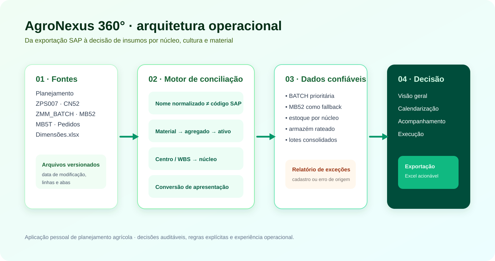
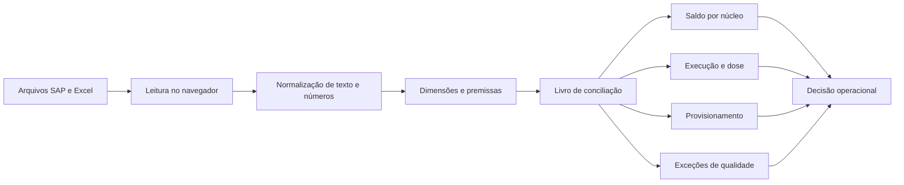
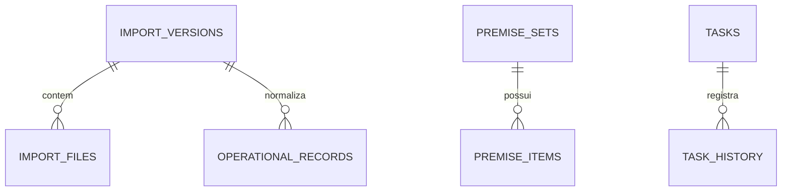

# AgroNexus 360°

<p align="center">
  
</p>

<p align="center"><strong>Planejamento agrícola, conciliação SAP e inteligência de insumos em uma única experiência operacional.</strong></p>

<p align="center">
  <a href="https://agronexus-360.vercel.app">Aplicação em produção</a> ·
  <a href="#arquitetura">Arquitetura</a> ·
  <a href="#motor-de-conciliação">Motor de conciliação</a> ·
  <a href="#evolução-planejada">Roadmap</a>
</p>

> Projeto pessoal de **Emmanuel Fortunato**, Analista de Planejamento. O AgroNexus 360° transforma uma rotina complexa de planilhas, exportações SAP e validações manuais em um produto digital auditável, orientado a decisão e construído a partir de regras reais da operação agrícola.


## Por que este projeto existe

Planejamento de insumos não termina quando um plano é aprovado. Ele depende de conciliar continuamente demanda prevista, execução registrada, estoque físico, materiais em trânsito, pedidos pendentes e particularidades de cada núcleo produtivo.

Na prática, esse processo costuma ficar espalhado entre relatórios SAP, planilhas com Power Query, tabelas dinâmicas e conhecimento tácito da equipe. O AgroNexus 360° cria uma camada de decisão para responder perguntas que deveriam estar prontas para a gestão:

- Quanto do planejamento já foi executado, por cultura, ciclo, núcleo ou subgrupo?
- Qual produto está em risco de ruptura na próxima janela de aplicação?
- O estoque está na fazenda certa, no armazém ou em trânsito?
- Uma alteração de dose aumentou ou reduziu a necessidade de volume?
- O que não conciliou por novo cadastro, apresentação diferente ou erro na origem?

Não é um dashboard genérico. É uma aplicação de planejamento construída com a pergunta operacional como ponto de partida e com engenharia de dados como meio para reduzir incerteza.

## O que este projeto demonstra no meu currículo

| Competência | Evidência no AgroNexus 360° |
| --- | --- |
| Visão de negócio | Modelagem de decisões de insumos, calendário agrícola, risco de ruptura e priorização por núcleo. |
| Domínio SAP + Excel | Leitura de Planejamento, ZPS007, CN52, ZMM_BATCH, MB52, MB5T e pedidos pendentes. |
| Engenharia de dados aplicada | Normalização textual, modelo canônico de material, fallback de fontes e governança de exceções. |
| Produto digital | Interface responsiva, filtros, detalhamento progressivo, exportações Excel e feedback de qualidade. |
| Rastreabilidade | Regras de WBS, centro, depósito, lote, conversão e saldo são explícitas e auditáveis. |
| Autonomia técnica | Projeto pessoal publicado, versionado e evoluído a partir de problemas reais de planejamento. |

## Capacidades atuais

| Frente | Entrega operacional |
| --- | --- |
| Visão geral | Execução por grupo/subgrupo, Safra e Safrinha, macro por cultura e indicadores de risco. |
| Calendarização | Provisionamento por período, demanda, saldo de fazenda, trânsito, armazém e volume solicitado. |
| Acompanhamento | Agrupamento por princípio ativo, totais por grupo, filtro de núcleo e detalhamento por material/localização. |
| Execução | Volume planejado x executado, percentual, dose planejada x realizada e impacto da diferença de dose. |
| Importações | Sete fontes, Dimensões, datas dos arquivos, indicador de defasagem e persistência local. |
| Conciliação | Relatório de itens sem dimensão, descrição ou núcleo, com ação sugerida e exportação Excel. |
| Premissas | Consulta tabulada de regras operacionais, mapeamentos, centros, culturas e conversões aplicados. |

## Visão do fluxo

<p align="center">
  
</p>



## Arquitetura

```text
┌────────────────────────────────────────────────────────────────────────────┐
│                              EXPERIÊNCIA WEB                                │
│ React 19 + TypeScript + Vite + XLSX                                         │
│ Visão geral | Calendarização | Acompanhamento | Execução | Importações      │
└────────────────────────────────────────────────────────────────────────────┘
                                      │
                                      ▼
┌────────────────────────────────────────────────────────────────────────────┐
│                         CAMADA DE DOMÍNIO E CONCILIAÇÃO                      │
│ material-dimension.ts  → dimensões, nomes normalizados e materiais padrão  │
│ reconciliation.ts      → WBS, núcleo, estoque, trânsito, consumo e pedidos │
│ page.tsx               → regras de visualização e decisões operacionais     │
└────────────────────────────────────────────────────────────────────────────┘
                                      │
                   ┌──────────────────┴──────────────────┐
                   ▼                                     ▼
┌──────────────────────────────────────┐   ┌────────────────────────────────┐
│ Persistência atual                    │   │ Caminho de persistência central │
│ IndexedDB no navegador                │   │ Worker + D1 + R2 + Drizzle      │
│ dados no mesmo dispositivo            │   │ estrutura preparada no projeto   │
└──────────────────────────────────────┘   └────────────────────────────────┘
```

### Stack

| Camada | Tecnologias | Responsabilidade |
| --- | --- | --- |
| Interface | React 19, TypeScript, Vite, Lucide | UX, filtros, tabelas, cards, modais e exportações. |
| Leitura de arquivos | SheetJS (`xlsx`) | Importação de `.xlsx`/`.xls`, cabeçalhos e geração de relatórios Excel. |
| Regras de negócio | TypeScript puro | Conciliação, conversões, classificação de estoque e cálculos de decisão. |
| Persistência local | IndexedDB | Mantém cargas, dimensões, premissas e tarefas no mesmo navegador. |
| Produção | Vercel + SPA Vite | Publicação estática, rápida e independente da API central. |
| Evolução central | Cloudflare Workers, D1, R2 e Drizzle | Base para versões compartilhadas, auditoria e armazenamento centralizado. |

### Estrutura de código

```text
plataforma/
├── app/
│   ├── page.tsx                  # Interface, cálculos e persistência local
│   ├── api/imports/route.ts      # Rota de ingestão central preparada
│   └── globals.css               # Tema e estilos globais
├── components/
│   └── dimension-upload.tsx      # Leitura de Dimensões.xlsx e Premissas
├── lib/
│   ├── reconciliation.ts         # WBS, núcleo, saldo e conciliação
│   ├── material-dimension.ts     # Normalização e conversões
│   └── operational-normalization.ts
├── db/schema.ts                  # Versões, arquivos, premissas e auditoria
├── worker/index.ts               # Worker para implantação Cloudflare
├── docs/assets/                  # Diagramas técnicos deste README
├── vite.vercel.config.ts         # Build SPA para Vercel
└── vercel.json                   # Rewrites e produção
```

## Fontes de dados e contratos de entrada

| Fonte | Papel no produto | Exemplos de campos reconhecidos |
| --- | --- | --- |
| Planejamento | Demanda prevista, dose, área, WBS e data de aplicação | Material, Classificação, Núcleo, WBS, data, volume e área. |
| ZPS007 | Execução e área registrada | DiagRede, Operação, Área Executada e status. |
| CN52 | Consumo/aplicado | Elemento PEP, material, quantidade retirada e centro. |
| ZMM_BATCH | Fonte prioritária de estoque | Centro, depósito, lote, texto breve, utilização livre e armazém/cidade. |
| MB52 | Estoque complementar | Centro, depósito, texto breve e utilização livre. |
| MB5T | Materiais em trânsito | Centro/destino, descrição e quantidade. |
| Pedidos pendentes | Volume solicitado ainda em aberto | Centro, Descrição Material, Saldo Forn ou Qtd.pedido. |
| Dimensões.xlsx | Semântica operacional | Ativo, grupo, subgrupo, material agregado, centros, culturas e fatores. |

### Estratégia de ingestão

1. O usuário seleciona uma ou mais fontes na Central de importações.
2. A aplicação lê a planilha ou identifica a linha de cabeçalho compatível quando o layout exige.
3. Cada arquivo recebe metadados de nome, abas, quantidade de linhas, data de modificação e data da importação.
4. Linhas e premissas são persistidas em IndexedDB; a carga volta ao abrir a aplicação no mesmo navegador.
5. Os visuais são recalculados a partir do conjunto de dados conciliado, sem cópia manual entre planilhas.

> A persistência atual é local ao navegador. Para a fase pessoal do projeto, isso reduz infraestrutura e mantém velocidade. A camada D1/R2 já modelada no repositório abre caminho para colaboração, versionamento e governança central.

## Motor de conciliação

### A chave é a semântica do material, não o código SAP

O código SAP é preservado para auditoria, mas não compõe a chave operacional. A conciliação usa a hierarquia:

```text
Princípio ativo
  └── Material agregado (padrão)
        └── Material físico / apresentação em estoque
```

Antes do vínculo com as dimensões, os nomes passam por normalização:

```text
"VÉRTIMEC 84 SC" → "VERTIMEC84SC"
"Vertimec-84 SC" → "VERTIMEC84SC"
```

Essa etapa reduz falsos negativos por acentuação, caixa, hífen ou pontuação e mantém a lógica aderente à forma como os produtos aparecem no SAP e nas planilhas.

### WBS e núcleo produtivo

O padrão de WBS tratado pelo projeto é:

```text
[Cultura].[Fazenda].[Safra].[Talhão]-[Índice]

Índice: A=1 · B=2 · C=3 · D=4 · E=5
```

| Contexto | Regra | Resultado |
| --- | --- | --- |
| Planejamento | Talhão inicia com `TL` | `NC-TP` |
| Planejamento | Talhão inicia com `FM` | `NC-STM` |
| Planejamento | Talhão inicia com `BM` | `NC-BBJ` |
| Planejamento | Núcleo `NC-VER` | normaliza para `NC-AGV` |
| CN52 | Centro `FBJ2` e talhão `FM` | `NC-STM` |
| CN52 | Centro `FBJ2` e talhão `BM` | `NC-BBJ` |
| CN52 | Talhão inicia com `TL` | `NC-TP` |
| Estoque | Centro `FVR1` | `NC-TP` |
| Estoque | `FBJ2` + depósito `TR01` | `NC-BBJ` |
| Estoque | `FBJ2` + depósito `UTS1` | `NC-STM` |
| Estoque | Depósito vazio | pool de armazém `BRAVO` |

As regras são delimitadas por contexto. Uma exceção aplicada ao estoque não altera silenciosamente o planejamento ou o trânsito.

### Conversão de apresentação física

O fator da dimensão é indexado pela composição:

```text
material padrão | apresentação física
```

Quando há fator válido:

```text
quantidade padronizada = quantidade física / fator de conversão
```

Se o Planejamento já informar `Volume ajustado (produto) padrão`, esse valor tem precedência. Essa decisão evita reprocessar um volume já ajustado por regra operacional anterior.

### Estoque, armazém e fallback MB52

| Conceito | Regra implementada |
| --- | --- |
| Fazenda | Saldo com depósito preenchido e centro diferente de `0714`. |
| Armazém | Centro `0714` ou depósito vazio; localização formada por `Nome Est.Esp. - Local Est.Esp.` quando disponível. |
| Lote | Não divide a decisão visual: lotes iguais são consolidados por tipo, material físico e localização. |
| BATCH | Fonte prioritária, pois contém saldo, lote e contexto de armazém/cidade. |
| MB52 | Fallback: só entra quando a apresentação física não existe na BATCH, impedindo dupla contagem. |
| Saldo zero | Não cria disponibilidade artificial para fazenda ou armazém. |
| Armazém central | É rateado uma única vez por material agregado no provisionamento. |

### Fórmulas operacionais

```text
Demanda da janela = max(0, planejado − aplicado)

Disponibilidade local = saldo da fazenda + trânsito

Saldo após atendimento = disponibilidade local + apoio do armazém − demanda

A entregar = saldo + aplicado + trânsito − quantidade planejada

Impacto de dose = volume executado − (dose planejada × área executada)
```

O indicador **A entregar** é codificado visualmente: positivo em verde, negativo em vermelho e zero em preto.

## Governança e qualidade de dados

O sistema não converte ausência de dado em saldo zero. Registros que não podem ser conciliados viram evidência para correção.

### Relatório de conciliação

A Central de importações gera uma tabela e uma exportação Excel para os casos abaixo.

| Diagnóstico | Leitura | Próxima ação sugerida |
| --- | --- | --- |
| Descrição de material ausente | A origem não permitiu identificar o produto. | Corrigir a descrição no arquivo SAP/Excel. |
| Sem vínculo nas dimensões | Produto existe na fonte, mas não possui semântica operacional cadastrada. | Criar cadastro ou corrigir grafia em Dimensões.xlsx. |
| Núcleo não conciliado | Centro/Fazenda não encontrou uma regra de destino. | Criar ou ajustar Centro/Fazenda → Núcleo. |

### Indicador de atualização

O card usa o arquivo operacional mais antigo carregado para impedir que uma fonte recente esconda outra fonte defasada.

| Idade do arquivo | Estado | Intenção |
| --- | --- | --- |
| Até 12 horas | OK | Base apta para acompanhamento diário. |
| Acima de 12 horas até 2 dias | Em atenção | Revisar se a rotina de atualização ocorreu. |
| Acima de 2 dias | Necessita atualizar | Recomenda-se uma nova carga antes da decisão. |

## Visões de decisão

### Visão geral

- Percentual de execução de materiais.
- Execução por subgrupo, separada entre Safra e Safrinha.
- Macro por cultura.
- Indicadores de saldo com atenção, pedidos pendentes e cobertura de vínculos.

### Calendarização e provisionamento

- Intervalo de avaliação configurável a partir da data atual.
- Demanda do período baseada no Planejamento.
- Saldo por núcleo, trânsito, volume solicitado e apoio do armazém.
- Status por linha: atende no núcleo, atende com armazém ou falta.
- Detalhe micro de fazenda, armazém e trânsito sem multiplicar volume por lote.
- Exportação Excel em abas de resumo e detalhes.

### Acompanhamento

- Filtros por ciclo, grupo, subgrupo, cultura, núcleo e busca textual.
- Agrupamento por princípio ativo e linha total por grupo.
- Expansão: material padrão → material físico → localização.
- Armazém apresentado como núcleo próprio, sem misturar saldo central e saldo de fazenda.
- Excel com abas de acompanhamento, totais por ativo e detalhes.

### Execução

- Planejamento x consumo aplicado do CN52.
- Área executada do ZPS007 vinculada por Diagrama/Rede e Operação.
- Dose realizada comparada à dose planejada.
- Impacto de volume causado por aumento ou redução de dose.

## Premissas como produto, não como nota de rodapé

| Domínio | Exemplos |
| --- | --- |
| Regras operacionais | Tolerância, amostra mínima, horizonte de demanda e status excluído. |
| Material | Nome físico → material agregado, princípio ativo, grupo e subgrupo. |
| Centro/Fazenda | Centro ou fazenda → núcleo responsável. |
| Cultura | Cultura → ciclo Safra ou Safrinha. |
| Conversão | Material padrão + apresentação física → fator. |

As premissas deixam de ficar escondidas em fórmulas. A tela de Premissas oferece uma visão tabulada de todos os valores em uso, e mudanças manuais entram no mesmo motor de conciliação.

## Privacidade e postura de dados

- Arquivos operacionais não são enviados automaticamente para serviços externos na versão publicada em Vercel.
- A carga atual é processada e persistida no IndexedDB do navegador do usuário.
- Dados de exemplo e arquivos SAP reais não fazem parte do repositório.
- A evolução central proposta preserva versionamento, metadados e trilha de auditoria no desenho de banco.

## Como executar localmente

### Pré-requisitos

- Node.js `>= 22.13.0`
- npm

### Instalação e desenvolvimento

```powershell
npm install
npm run dev
```

### Verificações

```powershell
npm run lint
npm run build:vercel
```

### Alvos de publicação

| Alvo | Comando | Observação |
| --- | --- | --- |
| Vercel | `npm run build:vercel` | Gera a SPA em `dist-vercel/`. |
| Worker local | `npm run build` e `npm run start` | Exercita o caminho Cloudflare/Vinext. |

O `vite.vercel.config.ts` isola a SPA para produção, enquanto `vite.config.ts` preserva a configuração de Worker e conectores da evolução Cloudflare.

## Modelo de dados preparado para evolução central



O schema Drizzle já separa responsabilidades de versões, arquivos, registros normalizados, premissas, tarefas e auditoria. Esse desenho permite evoluir para:

- Cargas versionadas e ativação controlada.
- Auditoria de arquivos e registros normalizados.
- Premissas com vigência.
- Tarefas e histórico de ações.
- Integração futura com autenticação, banco central e colaboração entre times.

## Evolução planejada

| Horizonte | Evolução | Valor esperado |
| --- | --- | --- |
| Curto prazo | Refinar relatório de exceções, exportações e regras de dimensões. | Menos correção manual e maior confiança no dado. |
| Médio prazo | Persistência central com D1/R2 ou banco relacional gerenciado. | Versões compartilhadas e histórico de cargas. |
| Médio prazo | Autenticação e perfis de acesso. | Governança entre gestor, analista e equipe de campo. |
| Médio prazo | Alertas proativos por D-15, ruptura e atraso de atualização. | Antecipação de compra, transferência e aplicação. |
| Longo prazo | Integração automatizada com SAP e eventos de logística. | Menos arquivos manuais e operação próxima do tempo real. |
| Longo prazo | Simulações de cenário por dose, janela e movimentação. | Planejamento mais robusto frente a desvios de execução. |

## Narrativa profissional

> “O AgroNexus 360° nasceu de uma necessidade real do meu trabalho como Analista de Planejamento: transformar relatórios e planilhas operacionais em decisões rápidas, confiáveis e explicáveis. O projeto combina conhecimento de agronegócio, SAP, Excel, modelagem de dados, UX e desenvolvimento de software. Mais do que visualizar indicadores, ele estrutura regras de negócio que antes dependiam de interpretação manual e cria uma base para uma gestão de insumos orientada por dados.”

## Autor

**Emmanuel Fortunato** · Analista de Planejamento · Projeto pessoal de portfólio e inovação operacional.

---

Se este repositório ajudou a enxergar como conhecimento de planejamento pode virar produto digital, uma estrela no GitHub é bem-vinda.
